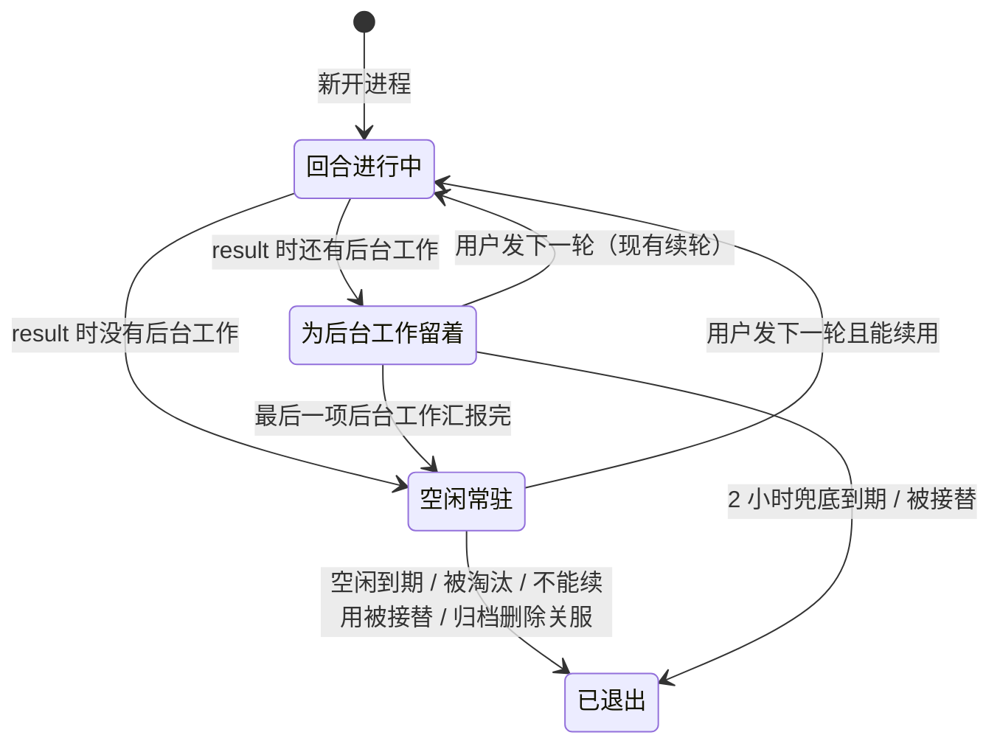

# Claude 会话常驻

> 状态：待评审（2026-10-21）
> 目标：Claude 会话一轮结束后，CLI 进程留一段空闲时间。用户在这段时间里发的下一轮直接写进这个进程，不再新开进程、不再续接整份记录。

## 为什么要改

先看一个例子。用户在一个聊了两千多行的 Claude 会话里发"好的，继续"。现在 CloudCLI 的处理是：

1. `queryClaudeSDK` 起一个新的 CLI 进程，带 `resume` 选项指向这个会话。
2. 新进程从磁盘读完整份 transcript（这个例子是 18MB），重建对话，然后才把请求发给模型。
3. 回复结束、收到 `result` 后，`releasePromptStream()` 关掉输入流，进程退出。

下一轮从第 1 步重来。上一轮进程里已经建好的对话状态，每轮都扔掉一次。

只有一种情况进程会留下来：本轮启动的后台工作还没结束（[Claude 驻留进程续轮](Claude驻留进程续轮.md)，代码里是 `heldForBackgroundWork`）。这时下一轮通过 `continueTurn` 写进同一个进程。这条续轮通道已经能切换模型、权限模式和效果档位，也处理了停止、交接窗口和进程中途死掉的情况。本方案要做的，是让没有后台工作的进程也走这条通道。

## 实测依据

2026-10-21 用仓库里的 agent SDK（0.3.303）驱动 CLI，模型 haiku，每轮提示词都是"只回复一个字：好"。下表的时间从发出这一轮算起。

| 场景 | 新开进程续接 | 同一进程接着发 |
| --- | --- | --- |
| 新建的小会话，到 `system/init` | 2.2–2.5 秒 | 0.12 秒 |
| 新建的小会话，到 `result` | 4.4–4.8 秒 | 1.4–1.9 秒 |
| 18MB 会话（约 69 万 token 上下文），到第一条回复 | 13–26 秒 | 1.5–1.8 秒 |

18MB 那一行说明慢在哪里。同一进程里接着发时，请求同样带着 69 万 token 的上下文，缓存命中（`cache_read_input_tokens` 约 68.8 万），1.5 秒就有回复。新开进程续接时，`system/init` 在 2.6–3.5 秒到达，之后还要再等 10 到 23 秒才有第一条回复。多出来的时间花在新进程续接记录上，不在模型。

数据的局限：大会话只测了一个，两次新开进程分别是 13 秒和 26 秒，波动很大。只能说"大会话每轮多等 10 秒以上"这个量级可信，具体数字不准。测试用的是 18MB 会话的副本，放在临时项目目录里，测完已删除。

内存：本机一个空闲的 CLI 进程（`claude --session-id ...`，后台会话）RSS 约 230MB。Codex 一个 app-server 进程组约 158MB（见 [Codex 会话驻留](Codex会话驻留.md)）。

## 方案

### 回合结束后留住进程

`result` 分支里，没有后台工作、也没有等着进来的下一轮时，现在直接 `releasePromptStream()`。改成进入"空闲常驻"：输入流保持打开，启动空闲计时。下面任一情况发生时才关掉输入流、让进程退出：

- 空闲计时到期。默认 10 分钟，与 Codex 一致，可用 `CLOUDCLI_CLAUDE_RESIDENT_IDLE_MS` 覆盖，设为 0 就回到现在的每轮退出。
- 常驻进程数超过上限，这个进程是最久没用的那个。默认上限 4 个，可用 `CLOUDCLI_CLAUDE_RESIDENT_MAX` 覆盖。
- 下一轮不能续用这个进程（见下一节），新进程接替它。现有的接替逻辑（`addSession` 的 superseding 分支）照旧生效。
- 会话被归档、删除，或服务关闭（见"生命周期"）。

空闲常驻和为后台工作留着是两种状态，分开记。只有空闲常驻计入上限、参与淘汰。为后台工作留着的进程照旧用 `BG_WAIT_CEILING_MS`（2 小时）兜底，不被淘汰，因为淘汰它会杀掉正在跑的工作。后台工作汇报完、进程没别的事以后，转入空闲常驻，从这时起开始算 10 分钟。

空闲常驻不发后台任务条（`background_tasks` 状态帧），也不让会话显示正在处理。页面上看不出进程还活着，唯一的区别是下一轮回得快。

### 什么时候不能续用

现有判断照旧：工作目录、MCP 配置、用户的工具许可、ultracode 设置等启动时定死的选项（`heldProcessCompatibilityKey`）有变化；编辑重发（`resumeAnchorId`）或从头重来（`resumeFromScratch`）；离开启动时所在的 plan 模式；中途打开跳过权限；从 `--effort` 启动后回到默认档位。

常驻把进程寿命从一轮拉长到最多十分钟以后，多出两种需要新开进程的情况。

**1. 配置文件改了。** 进程启动时读过的配置，常驻期间改了它看不到：CLAUDE.md、settings.json、技能和命令。办法是在兼容判断里加一份配置指纹，内容是这些文件和目录的修改时间：

- `~/.claude/settings.json`、`~/.claude/CLAUDE.md`
- `<cwd>/CLAUDE.md`、`<cwd>/.claude/settings.json`、`<cwd>/.claude/settings.local.json`
- `~/.claude/skills`、`~/.claude/commands`、`<cwd>/.claude/skills`、`<cwd>/.claude/commands` 这几个目录

每轮多做十来次 `stat`。局限：目录的修改时间只在增删直接子项时变化，只改某个技能目录里的 `SKILL.md` 看不出来，要等空闲到期才生效。CLI 在终端里长时间开着的会话也有同样的局限，这里不比终端差。实施前先用探针确认：常驻进程是不是真的看不到 CLAUDE.md 的改动。如果 CLI 自己会重读，就把它从指纹里拿掉。

**2. 别的进程写了同一份记录。** 用户在常驻期间用终端 `claude --resume` 打开了同一个会话。常驻进程手里的对话状态不知道终端那边新增的内容，继续用它会让两边各走各的。今天在回合进行中就有这个风险，常驻把风险窗口拉长到十分钟。

办法是在进入空闲常驻时记下 transcript 的文件长度。续用前读这个长度之后新增的行，出现下面任一条就放弃续用，新开进程续接：

- `type` 为 `user` 或 `assistant` 的行。空闲常驻期间本进程不会自己写对话行，只会追加 `ai-title`、`cost-state` 这类元数据行。
- `continued-in` 行，即会话被终端转去了后台任务（2026-10-21 实际遇到过）。

这一条要用探针验证两件事：空闲期间本进程确实不写对话行；终端续接同一会话时写的是同一个文件。如果终端续接会新开 transcript 文件，就改成同时检查同目录下有没有更新的同会话文件。

**登录凭证**：`sdkOptions.env` 现在不进兼容判断。它就是服务进程自己的 `process.env`，CloudCLI 不往里注入 Claude 凭证（`claude-auth.provider.ts` 只检测凭证来源）。凭证写在 `~/.claude/settings.json` 的 `env` 里时，配置指纹已经覆盖；用订阅登录时，CLI 自己读 `~/.claude` 的登录状态。实施时确认用户在应用里切换 Claude 账号后，常驻进程会不会用新账号。如果不会，就把账号标识加进兼容判断。

### 生命周期

Codex 常驻引入了三个运行时接口（`server/shared/interfaces.ts`）：`hasSessionWork`、`closeSessionAdmission`、`releaseSession`。手动归档和删除会拒绝有活的会话，自动归档会跳过它，服务关闭时会关掉常驻进程。Claude 目前一个都没实现。本方案补上：

- `hasSessionWork`：回合进行中、有后台工作、或有已交接但还没写入的下一轮时为真。空闲常驻不算有活，归档和删除照常进行。
- `closeSessionAdmission`：会话之后的轮次不再续用常驻进程。
- `releaseSession`：关掉这个会话的常驻进程（空闲常驻或为后台工作留着的都关）。
- 服务关闭：在 `server/index.ts` 的关机流程里关掉所有 Claude 常驻进程。和 Codex 一样，PM2 重启本来也会杀掉子进程，这一步是为了让 CLI 正常退出、把记录写完整。

还有一处要改。历史读取靠 `activeSessions` 里有没有这个会话，来判断一个没汇报结果的后台 agent 是"还在跑"还是"已停止"（`addSession` 里的注释）。空闲常驻会让条目一直在，没汇报就结束的 agent 会被显示成还在跑。条目上要标出是否空闲常驻，历史读取据此把这类 agent 当作已停止。

## 代价与什么情况下反而亏

- **内存**：默认上限下，Claude 常驻进程最多约 4 × 230MB ≈ 0.9GB，加上 Codex 的上限，最坏约 1.5GB。为后台工作留着的进程不受上限约束，现在也是这样。
- **会话多、每个只聊一两轮**：进程留了十分钟没人用，白占内存，换不来任何提速。这种用法下应把 `CLOUDCLI_CLAUDE_RESIDENT_IDLE_MS` 调小或设为 0。
- **改技能内容后马上测**：常驻期间改技能目录里的文件，指纹看不出来（见上文局限），要么等空闲到期，要么改一下别的指纹文件。
- **只读型 hook 少触发**：`SessionStart` 之类的 hook 只在进程启动时触发。常驻后，一个会话连续聊天只触发一次，不再每轮一次。终端里就是这个行为，但如果用户有依赖"每轮触发"的 hook，行为会变。

## 不在本方案范围

- 会话标题。常驻不影响上一次的修复：同一进程里引擎照旧只自动起一次名，每轮的 `generateSessionTitle` 请求还是需要的。
- 回合进行中插话。前台回合没结束时，聊天网关照旧排队。
- ZCode 和 Codex。Codex 已有自己的常驻管理；ZCode 用常驻协议客户端，不涉及。

## 改动范围

后端：`claude-runtime.provider.js`（空闲常驻状态、计时、上限与淘汰、配置指纹、外部写入检查）、`claude.provider.ts`（三个生命周期接口）、`claude-sessions.provider.ts`（历史读取的 agent 状态判断）、`server/index.ts`（关机时关常驻进程）。
文档：`docs/core/providers.md`（Claude 进程生命周期）、`docs/core/overview.md`（关机流程）。
前端：不改。

## 测试与验收

单元测试沿用 `claude-runtime-hold.test.ts` 的脚本化 query（`context.createQuery`）：

- 没有后台工作的一轮结束后，进程不退出；下一轮不调用第二次 `createQuery`，消息写进同一条输入流。
- 空闲到期后输入流关闭；`CLOUDCLI_CLAUDE_RESIDENT_IDLE_MS=0` 时行为与现在相同。
- 第 5 个会话进入空闲常驻时，最久没用的那个被关掉；为后台工作留着的进程不被关。
- 配置指纹变化、transcript 出现外部对话行或 `continued-in` 时，下一轮新开进程。
- 后台工作汇报完后转入空闲常驻，计时从这时开始。
- `hasSessionWork`：空闲常驻为假；回合中、有后台工作时为真。`releaseSession` 关掉进程。
- 空闲常驻期间，没汇报的 agent 在历史里显示为已停止。

真实引擎探针（`scripts/probe/claude-resident.probe.mjs`，临时项目目录，不碰生产会话）：

- 用大会话副本对比改前改后的第二轮到首条回复时间，验收标准是同一进程续轮的耗时不随记录大小明显增长。
- 常驻期间修改 CLAUDE.md，确认 CLI 是否自己重读，决定指纹要不要包含它。
- 常驻期间用终端续接同一会话，确认外部写入检查能发现。
- 常驻期间本进程只写元数据行，不写对话行。

交付前请用户在自己的大会话上连续发几轮，确认第二轮起回复明显变快。
