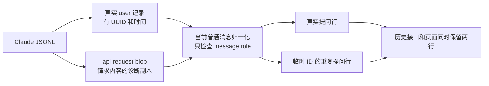

# Claude 转录记录筛选

> 基准：2.10.0 / 2026-10-20
> 状态：已完成代码与接口回归、独立代码审查和产品评审；未部署，浏览器验收未执行

## 现场与原因

用户只发送一次“进入工作树……”的提问，聊天中却出现两份相同提问。诊断报告显示，两份都在服务端历史数组中：一份使用真实转录行的 UUID，另一份使用 `vol_claude_…_text_3`。历史中还有一张使用 `vol_claude_…_1` 的重复 Bash 卡。

报告采集于 `2026-10-19T15:58:12.906Z`，页面构建为 `v2.10.0-96b76ca4`。目标会话的收帧没有重复序号；发出的提问只有原问题和后续的“继续”，没有第二次发送原问题。这一例不是重复提交，也不是[聊天事件重放](聊天事件重放.md)中的同一事件被执行两遍。

真实转录同时保存两类记录：

- `type: user` 是真实提问，带有转录 UUID 和时间。
- `type: api-request-blob` 是模型请求的诊断快照。快照里的 `message.role` 也可以是 `user` 或 `assistant`，内容可以包含原提问、思考和工具调用，但快照不是新发生的对话。

本次用户快照的文本块逐字包含真实提问，助手快照包含真实 Bash 调用。这些快照没有转录 UUID 和时间。`ClaudeSessionsProvider.normalizeMessageRows` 的普通消息分支只看 `message.role`，把快照当成对话，再为它生成临时 ID 和读取时刻的时间戳。真实行和临时行身份不同，前端不能按 ID 合并，于是两份都显示。

此前“模型识别与 1M 区分”会话的原始文件也有同样的用户请求快照，文本块同样包含原提问。因此此前只统计 `type: user` 的办法没有覆盖真正进入归一化的全部输入；该会话也需要按这条记录边界修复。

## 版本证据与复现边界

版本对照使用相同的 Agent SDK、最小提问和配置，分别启动本机 CLI `2.1.299` 与 `2.1.303`，检查各自在隔离目录生成的真实转录：前者没有请求快照，后者包含 `api-request-shape`、`api-request-blob` 和 `api-request`。两次用户重复现场的真实转录版本都是 `2.1.303`。

这说明输入记录格式的变化能够让旧的宽松读取逻辑暴露问题。对照没有覆盖两个版本之间的全部版本，不能据此声称 `2.1.303` 就是最早引入诊断记录的版本，也不能把原因归到 CloudCLI 某次依赖声明修改。

复现使用以下实际路径和对照：

| 验证 | 结果 |
| --- | --- |
| 把现场用户请求快照传给真实 `normalizeMessage` | 错误生成与原提问相同的用户行 |
| 把现场助手请求快照传给真实 `normalizeMessage` | 错误生成相同工具调用的 Bash 行 |
| 调用现场会话的真实 `fetchHistory` | 返回真实提问和临时 ID 的提问副本 |
| 从同一批原始记录中排除请求快照，再执行现有归一化 | 真实提问仍存在，副本消失 |
| 用相同快照形态检查子代理历史与搜索解析 | 诊断内容被当成活动或搜索结果 |

子代理与搜索验证使用临时暴露私有解析函数的探针和构造快照，确认相同代码入口存在问题；这不等于已经捕获了这两个界面的真实用户故障。正式回归测试需要通过各自的生产调用入口执行。

## 修复原则

记录的用途由顶层 `type` 决定，不能因为嵌套对象长得像消息，就把它视为聊天事实。普通对话分支只接收匹配的真实 `user`、`assistant` 记录。诊断快照及其他非对话记录不进入普通对话归一化、工具结果配对、搜索正文或子代理活动。

不通过比较正文删除副本。用户连续发送相同提问时，两条真实记录都要保留；两个真实工具调用即使参数相同，也不能被合并。也不能只检查 UUID：合法实时控制事件不一定有转录 UUID，缺失 UUID 不能成为全局丢弃条件。

修复分两层实施：

1. 历史消费者先按用途筛选记录，避免请求快照进入分支选择、通知归集和工具结果配对。
2. 普通消息归一化再检查记录类型与角色是否匹配，防止其他调用入口把诊断快照传进来。

共享的 Claude 真实对话记录判定放在 `server/shared/utils.ts`，通过共享模块入口使用。主历史、子代理历史和搜索复用同一判定，不各自复制记录类型名单。判定只负责记录类别和必要形状，不夹带历史排序、文本清理或转录分支规则。

## 各消费者的边界

### 主历史与普通归一化

`readTranscriptRows` 需要保留分支和后台状态所需的元数据，不能简单把整个文件过滤成只剩 `user`、`assistant`。

例如，`last-prompt` 决定恢复分支，`progress` 参与父链连接，`system` 的压缩边界影响恢复路径，`queue-operation` 可能是后台任务结果的唯一来源。`attachment` 也参与转录分支。因此读取器应按用途把已知元数据交给对应消费者，而不是把它们送入普通消息分支。

`normalizeMessageRows` 中根据 `message.role` 识别的普通提问、回答和压缩摘要分支，需要同时要求正确的记录类型。已有明确类型的实时文字、思考、工具、系统任务状态和完成处理保留原有语义。未知记录即使包含 `message.role`，也不自动成为普通对话。

类型检查必须先于读取时间、生成临时 ID 和消费压缩摘要标记。否则诊断用户快照仍可能吃掉 `compact_boundary` 留下的一次性标记，使后面的真实压缩摘要被错误归类。

`fetchHistory` 的 `toolResultMap` 必须执行同样的边界检查。只修最后的归一化还不够：被忽略的请求快照仍可能先参与工具结果配对，并覆盖真实工具结果。

`readTaskNotificationTexts` 对真实用户通知和 `queue-operation` 分别读取，不从任意 `message.role: user` 的记录中提取通知。后台任务完成不能由诊断副本裁决。

### 子代理活动和搜索

`readClaudeSubagentTranscript` 只有确认真实助手或用户记录后，才提取工具、思考、正文和结果。请求快照不能改变活动列表、工具配对、模型或起止时间。

`extractClaudeSearchableMessage` 先确认对话记录类别，再执行现有的内部内容过滤、压缩摘要和本地命令处理。诊断快照中的指令、工具参数或原提问都不能成为额外的搜索正文。

### 用量与其他读取入口

当前 `claude-usage.ts` 和 Claude 历史用量读取均先要求 `entry.type === 'assistant'`，请求快照不进入用量计算。这两个入口确认已有类型边界，不为本次问题重写用量算法。

实施时横查 Claude 文件的其他消费者，特别是标题、编辑与 Fork 锚点、后台通知。已经按记录用途处理的入口保留原有规则；仍然只看嵌套角色的入口补同类回归测试。不能为了统一而删除每个消费者确实需要的元数据。

## 实施范围

| 位置 | 修改内容 |
| --- | --- |
| `server/shared/utils.ts` 与共享模块入口 | 提供唯一的真实对话记录判定 |
| `server/modules/providers/list/claude/claude-sessions.provider.ts` | 主历史筛选、普通消息边界、工具结果配对、通知归集和子代理活动 |
| `server/modules/providers/services/session-conversations-search.service.ts` | 在搜索文本提取前使用同一记录边界 |
| `server/modules/providers/tests/` 与共享测试 | 从生产入口锁定诊断快照误收，覆盖合法对话和必要元数据 |
| `docs/core/providers.md` | 同步 Claude 转录记录与模型请求诊断的边界 |

这是独立于事件重放协议的修复，不需要修改各引擎行 ID，不需要增加 WebSocket 代次字段，也不需要迁移或重写 Claude 转录文件。

## 验收

先用现场结构写失败测试，再写实现。夹具使用中性正文，保留真实记录与请求快照并存、快照没有 UUID 和时间、用户快照包含多个文本块等决定复现的条件。

| 场景 | 必须满足的结果 |
| --- | --- |
| 真实提问与包含原提问的请求快照共存 | 历史接口只返回真实提问，读取多次身份不变 |
| 真实回答、思考、工具及其请求副本共存 | 只保留真实对话和真实调用，不生成额外临时行 |
| 请求快照含工具结果或后台通知 | 不覆盖真实结果，不改变后台任务状态 |
| 用户真实发送两次相同提问 | 两条 UUID 不同的真实提问均保留 |
| 真实重复工具调用 | 每次调用及其结果均保留 |
| 搜索只命中请求快照里的文字 | 不产生聊天搜索结果 |
| 子代理文件含请求快照 | 快照不增加活动，不改变模型、起止时间和工具配对 |
| `last-prompt`、`progress`、附件与压缩边界 | 编辑、Fork 和恢复分支维持现有语义 |
| 压缩边界与真实摘要之间出现诊断用户快照 | 快照不消费摘要标记，真实摘要仍被识别为摘要 |
| 只有队列记录携带后台通知 | 后台任务仍能正确结算 |
| 合法实时事件没有转录 UUID | 不因本次筛选被丢弃 |
| 未知类型带有嵌套消息或顶层类型与角色矛盾 | 不进入普通对话；无效形状按边界规则报告 |
| 用量读取中混入请求快照 | 用量与只读取真实记录时一致 |

定向测试通过后运行 `npm test`、`npm run typecheck`、`npm run lint` 和 `npm run build`。开发页面还要验证历史重新加载、搜索、子代理卡片和后台结果。每项实测结果随交付报告；没有执行的界面验证明确标注。

历史缓存需要在新版本进程中重新建立，已经显示错误行的页面重新加载历史后按修复后的读取结果展示。原始文件保留不动，回滚只涉及代码。部署和 PM2 重启仍由用户执行。

实施在独立工作树完成，代码写完执行独立代码审查和独立产品评审。异常停止之后的 CLI 错误提示属于另一条运行结果处理链，本方案不把它当作重复消息的原因。

## 验证入口

仓库回归运行 `npx tsx --tsconfig server/tsconfig.json --test server/modules/providers/tests/claude-sessions.test.ts server/modules/providers/tests/provider-attachment-history.test.ts server/modules/providers/tests/large-provider-results.test.ts`。测试通过生产历史、搜索与工作流活动入口验证记录边界，包含真实正文正向命中、重复发送保留、诊断通知冲突和诊断时间不能改变运行状态。

全量后端测试、类型检查、lint 和构建均通过；跳过项和 lint 警告以命令输出为准。原始故障会话通过只读历史探针验证，真实提问保留且请求快照不生成副本。独立代码审查与产品评审没有阻断项。接口回归不等于浏览器验收，历史刷新、搜索跳转和卡片展开仍需在部署后的页面确认。
