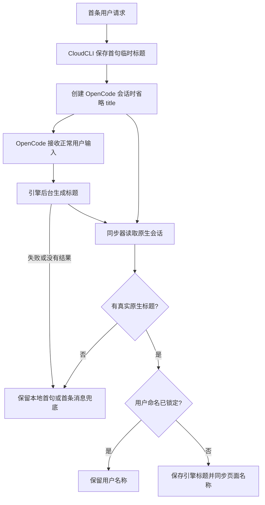

# OpenCode 会话标题

> 状态：已实施
> 基准：2.10.0 / 2026-10-20；CloudCLI 源码核对点 `3354f0a0`；本机 OpenCode 2.0.31，上游标签 `v2.0.31`

## 目标与范围

用户新建 OpenCode 会话并发送“尸王在哪里刷是随机的吗，好难找”后，CloudCLI 先显示首句。OpenCode 在后台生成例如“尸王刷新位置与寻找方法”的标题后，侧栏、聊天顶部和浏览器标题同步显示新名称。示例只表达标题含义，验收不要求模型逐字返回指定文字。

本方案修复新会话的自动命名入口、原生占位标题识别，以及名称到当前页面的同步。标题生成沿用 OpenCode 的模型选择、认证和后台任务，不在 CloudCLI 另建模型请求。标题生成不阻塞聊天，不产生聊天消息、未读提醒或后台任务卡片。用户手动命名优先。

已有会话默认保留名称，不在启动、打开会话或下一轮聊天时自动补生成。对用户明确选择的旧会话，可以另行调用原生重新生成接口；批量迁移和新增“重新生成标题”按钮不在本次实施范围。

## 证据与边界

截图对应原生会话 `ses_ea94009dbffersAfku7iu9sFOK`。只读查询本机 OpenCode 的 `session_v2` 时，`title` 就是截图中的首条提问。CloudCLI 会话 `dbfc753a-bc34-4e31-8a6d-a770da56e849` 保存了相同名称，`name_locked=0`。这条会话没有生成后遗漏同步的智能标题。

| 对象 | 核对位置 | 事实与影响 |
| --- | --- | --- |
| 创建入口 | `server/modules/providers/list/opencode/opencode-runtime.provider.ts`，`createOpenCodeRuntime` 内的 `run` | 建会话时传入 `title: sessionSummary`；首句占位名占满了引擎的自动命名位置 |
| 请求序列化 | `server/modules/providers/list/opencode/opencode-api.client.ts`，`createSession` | 非空 `title` 进入 `POST /api/session` 请求体；省略该字段已经受客户端支持 |
| 自动生成入口 | 上游 `packages/core/src/session/runner/llm.ts` | 正常输入进入运行时，只有根会话且 `SessionTitle.isUntitled` 成立，才提交后台标题任务 |
| 未命名判定 | 上游 `packages/util/src/session-title-fallback.ts`，`isExactRootFallback` | 标题缺失或等于该会话创建时间对应的精确默认标题，才算根会话未命名；普通首句不符合 |
| 标题存法 | 本机 `session_v2` 表 | 引擎未命名时 `title` 列为 NULL，兜底名 `New session - <建会话时间>` 只出现在接口展示层；同步器读库只会读到 NULL |
| 改名事件 | 本机 `opencode serve` 事件流 | 引擎改名发 `session.renamed`，带 `sessionID`、`title` 与事件时间；该事件时间就是引擎写进 `session_v2.time_updated` 的值 |
| 同步裁决 | `opencode-session-synchronizer.provider.ts` 的 `deriveSessionName`；`shared/sessions/session-title-resolution.ts` | 任意非空原生标题都被标为引擎命名；未锁定本地名会被覆盖 |
| 当前页面 | `src/modules/project-workspace/hooks/useProjectsState.ts` 的 `handleEvent` | `session_upserted` 更新项目列表；直接合并当前会话的分支只处理原生 id 归并，缺少普通同 id 名称合并。空闲当前会话触发历史刷新，其他分支标记需要关注 |
| 既有测试 | `server/modules/providers/tests/opencode-runtime.test.ts` | 新建请求断言包含 `title: 'Greeting'`，测试固定了阻止自动命名的接法 |

上游证据固定到本机对应版本：[自动生成入口](https://github.com/anomalyco/opencode/blob/v2.0.31/packages/core/src/session/runner/llm.ts)、[默认标题判定](https://github.com/anomalyco/opencode/blob/v2.0.31/packages/util/src/session-title-fallback.ts)、[标题任务](https://github.com/anomalyco/opencode/blob/v2.0.31/packages/core/src/session/title.ts)、[会话接口](https://github.com/anomalyco/opencode/blob/v2.0.31/packages/server/src/handlers/session.ts)。会话接口的 `PATCH /api/session/:id` 在 `title` 为空字符串时调用标题生成，非空时执行改名。

上述结论来自本机数据库、CloudCLI 源码、对应标签的上游源码，以及对本机 `opencode serve` 的实测：省略 `title` 建会话后库里存 NULL；改名会推进该行的 `time_updated`，且事件流里的改名事件时间与之一致。本轮没有跑真实模型请求，因此“引擎生成标题”这件事本身没有端到端实测过；生成成功率、耗时与额度属引擎行为，沿用引擎的模型选择与认证。

## 方案选择

| 候选 | 代价与更亏的条件 | 选择 |
| --- | --- | --- |
| 创建原生会话时省略 `title`，沿用引擎自动生成 | 需要处理默认标题和异步同步；生成耗时、额度及模型失败沿用引擎行为 | 采用，修复阻断点，不增加第二套命名任务 |
| 首轮结束后由 CloudCLI 调用原生重新生成 | 需要去重、锁定检查和并发处理；恢复引擎自动生成后还会重复请求 | 不用于新会话；仅作为明确选定旧会话的补救路径 |
| CloudCLI 自行请求模型生成 | 需要再维护认证、模型选择、超时和保存逻辑 | 引擎已有能力，当前不值得重复建设 |
| 扫描所有旧会话并批量重命名 | 消耗模型额度，且原生数据库没有足够的标题来源信息 | 不采用；首句相同也不能证明用户没有主动选择该名称 |

新建请求只传原生创建所需的目录等参数，省略 `title`。首句仍保存在 CloudCLI 的应用会话中。保留 API 客户端已有的可选标题能力；普通聊天调用方不再用首句填充该字段。

同步器把缺失标题和引擎默认标题视作占位信息，走现有 `generated: false` 裁决。已有本地首句时保留首句；从外部索引且没有本地名时，用首条用户文本补位。真实原生名称走 `generated: true`，由现有 `name_locked` 规则决定是否落库。默认标题判定按引擎的存储格式建立夹具：库里存的是 NULL，兜底名只在接口展示层出现，所以同步器只需认 NULL 与该会话创建时间对应的精确默认标题，不能把所有以 `New session` 开头的合法名称都过滤掉。

## 同步、并发与兼容

引擎的自动命名发生在它自己的进程里，CloudCLI 只能从两个地方看到结果：引擎改名后写进 `session_v2` 的那一行，以及引擎改名时发的事件流。两条路的分工是明确的。

**事件流是能确认变化来源的那条路。** 引擎改名发 `session.renamed`，带 `sessionID`、新标题和事件时间。runtime 收到后把标题写进 `sessions.custom_name`（`name_locked=1` 的行不写，用户的名字是终局），并推一条只带元数据的 `session_upserted`（`metadataOnly`）。前端收到这样的增量只改名字：不重读消息、不打待看标记、不改列表排序与活跃时间。事件时间就是引擎写进 `session_v2.time_updated` 的值，这条时间戳把事件与库里的行对上了。

**数据库扫描是不确认变化来源的那条路。** 引擎改名同样是一次写库，扫描会看到这一行，`time_updated` 也推进了，所以增量游标不会漏读。但扫描分不出这一行是被改名了还是被写了消息，两种变化在库里都只表现为 `time_updated` 前进。因此扫描这一路保持原义（客户端按老规矩重读消息、给后台会话打待看标记），只额外合并名字；「只有标题变化不触发历史刷新」由事件流那一路保证。

**跳过一行必须建立在「应用没落后」上。** 引擎把每个会话级事件都记进会话行的 `time_updated`，一次扫描只看得到最后一次写的时间戳：引擎先写消息、再改名，扫描看到的是改名的时间，看不到中间那次消息。所以 runtime 除了记住「这次改名我已经应用了」，还记住引擎最近一次会话事件的时间；只有它不晚于应用上次同步的时间，才说明应用没有欠着的变化，扫描才可以跳过这一行。应用若还欠着变化（引擎刚写完回复就改名，而扫描还没跟上），runtime 就不登记，扫描照常播这一行——消息不会因为改名被吞掉，改名跟着一起播出去，客户端合并名字即可。

**改名不是活动。** 引擎自己把改名算作一次活动（`time_updated` 跟着走），应用不跟着算：写名字不动会话行的活跃时间，否则下次列表刷新时这条会话会因为一个用户看不见的变化跳到按活跃排序的列表前面，相对时间标签也从「3 分钟前」跳回「刚刚」。

页面同步复用[Codex 会话标题](Codex会话标题.md)方案中的通用名称合并和仅元数据通知机制。该机制原先没有落地，作为本方案的公共前置改动一并实施，不依赖 Codex 驻留或 Codex 生成任务。两份方案共用一套事件、名称合并和合并函数：`SessionUpsertedEvent.metadataOnly` 标记加在共享协议里，前端复用共享类型，`useProjectsState.ts` 里那份重复的事件形状已经删掉。

仅元数据通知必须由能确认变更来源的服务端路径发出。不能仅凭两个推送里的名称不同，就认定没有新消息：标题与消息可能同时写入。无法判定时保留现有内容刷新语义，另补名称合并。验收需要明确证明“只有标题变化”不会触发历史刷新、需要关注标记或聊天滚动。

同 id 推送要合并当前会话名称，同时保留 provider、项目和原生 id 归并逻辑。断线重连通过现有列表重取恢复名称，不能只更新侧栏而把当前会话名称留在旧值。合并名字时沿用手动改名的做法：丢掉一次性搜索定位信息，否则新名字会把对话滚回先前搜索命中的位置。

用户在标题生成期间手动改名时，落库和同步器继续以 `name_locked` 为准。引擎随后生成的名称可以存在原生库中，但不得覆盖 CloudCLI 的手动名称。标题失败时保留首句；CloudCLI 不自行循环重试，也不把标题失败转换成聊天失败。

旧会话不会因省略新建参数而重新取得自动命名资格。用户明确要求补生成某条旧会话时，执行前核对应用 id、原生 id、归档状态和名称锁；通过原生接口生成，沿用相同同步规则，不直接改 OpenCode 数据库。这个接口是否产生额外推送、耗时多久及失败形态，须用独立测试会话验证后再用于用户会话。

## 同类场景检查

OpenCode 适配器内检索创建调用，只发现普通新建会话这一处把 `sessionSummary` 写入原生标题。已有会话续聊不走创建分支；子会话由引擎创建，并在索引中以 `parent_id` 排除。实施时仍需回归续聊、编辑重发、分支和子会话，验证它们不会借公共创建逻辑误删用户指定名称。

Claude、ZCode、Antigravity 和 Codex 的标题来源见现有提供方架构文档及 Codex 标题方案。本轮没有对其他引擎运行真实聊天，不能据此宣布其他引擎没有同类问题。公共页面名称合并覆盖所有提供方，必须回归手动改名、原生 id 归并和后台会话提醒。Cursor 的自动命名属于独立能力缺口，不并入本次修复。

## 实施结果与验收

实施在独立工作树完成，先写能复现问题的失败测试，再写实现。涉及的落点：OpenCode runtime（省略标题、接改名事件）、OpenCode 会话同步器（占位标题判定、跳过已应用状态）、OpenCode 引擎改名模块（记住已应用状态与引擎最近一次会话事件）、同步器基类（`isProviderStateAlreadyApplied` 钩子）、`sessions.db.ts`（引擎名字的条件写入）、共享协议与广播（`metadataOnly`）、前端项目状态（名称合并与仅元数据分支）、聊天会话状态（重读消息只认会话 id）、以及 `docs/core/providers.md`、`docs/core/chat.md`、`docs/core/frontend.md`。

真实模型请求没有在本轮执行，因此“引擎把首句概括成短标题”这一段仍待端到端实测。已实测并写进测试的是：省略标题建会话后请求体没有 `title`；引擎改名后的事件能落到应用行上并以仅元数据增量下发；用户改名后引擎的名字不覆盖；兜底名按精确格式判占位、同前缀的真实标题照常当引擎命名；runtime 应用过的改名不会被扫描再播一遍；应用还欠着变化时扫描照常播这一行（消息不会被改名吞掉）；只有标题到达时当前会话不重读消息、不打待看标记。

真实验收仍要分别检查侧栏、当前聊天顶部和浏览器标题，并验证标题晚于聊天结束到达、用户立即续聊、后台会话命名和切换会话期间到达的更新。通过条件是名称归属正确、无额外聊天消息、无标题引起的未读提醒、不重置聊天内容或滚动位置。

发布前完成工作树 rebase、复验和仓库合并流程。部署和 PM2 重启只由用户执行。回退代码不会撤销已生成的原生名称；本方案没有数据库迁移，也不批量重写旧会话名称。
