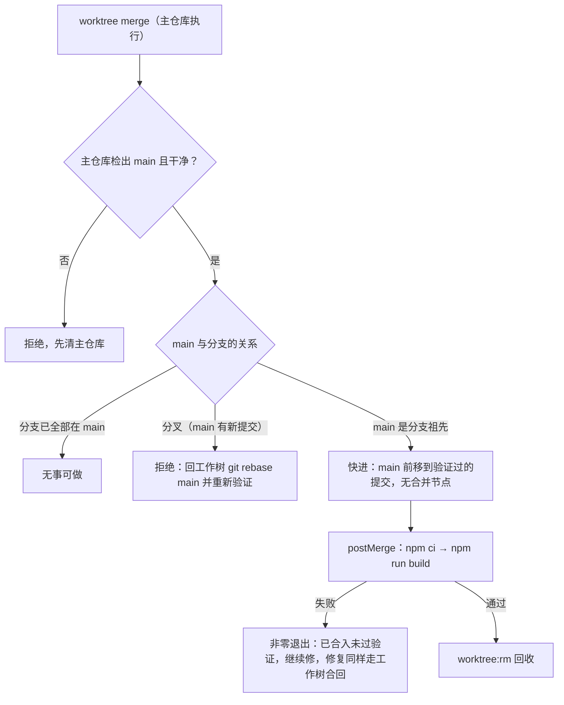

# 并行开发工作树

> 基准： 2.10.0 / 2026-10-18

`npm run worktree:*`（实现在 `scripts/worktree/`，移植自 nexus-kit 的 devflow 包）让多条改动线——多个终端、
多个 AI 会话——同时在这个仓库里干活而不互相踩脚。三条不变量：**合进 main 的每个提交都是先在工作树里验证过的**、
**并行线各用各的目录和端口**、**回收不丢东西**。

## 一条改动线的一生

主仓库检出 main。拿 `feat/login` 从头走一遍：

1. `npm run worktree:new feat/login` 在 `.worktrees/login` 建出工作树（自 main 新建分支），在新树里跑
   `npm ci` 装依赖（几分钟），并登记开发端口：第一棵树服务端 3011、vite 3012，第二棵 3021/3022，依此加 10；
   分配时避开所有已登记和正在监听的端口。端口号写进这棵树自己的 git 目录（`.git/worktrees/login/worktree-port`），
   随树一起消失，不进版本库。命令结尾打出本树的启动方式：
   `SERVER_PORT=3011 VITE_PORT=3012 npm run dev`——服务端和 vite 本来就认这两个环境变量，产品代码零改动。
2. 在工作树里开发、提交、验证，浏览器开 `http://localhost:3011`。
3. 别的线可能先合进了 main。本线做完后在工作树 `git rebase main`，在变基后的代码上重新验证。
4. 回主仓库 `npm run worktree:merge feat/login`。脚本先确认主仓库检出 main 且干净，然后只做快进；
   合入后在主仓库跑 `npm ci && npm run build`，失败非零退出——已合入但没通过验证，必须继续修。
5. `npm run worktree:rm login` 回收：先删工作目录落在树内的 pm2 应用、停掉树里起的服务，再把「删了就找不回」
   的东西列出来拒绝执行（未提交改动、temp/ 里的手写脚本等），确认都不要了加 `-- --force`，最后删目录。分支保留。

## 为什么合入只快进

合入前分支已经变基到最新 main 并验证过，快进让 main 指向的正好是验证过的那个提交。真合并会造出没人跑过的
组合代码，冲突还会留在主仓库卡住其他线——所以分叉即拒绝，主仓库不做任何改动。并发的两个合入靠
`.git/worktree-merge.lock` 目录锁互斥，另一个合入正在进行时立即拒绝不排队：排到时 main 已前移，快进资格
早没了。持锁进程已死或锁超过 20 分钟视为残锁，自动清理。

## 回收判定

`git worktree remove` 只拦未提交改动，不管树里起的服务。`worktree rm` 先读 `git status --porcelain --ignored`，
把每一行分成两类：**可再生，随树删**（node_modules、dist/、coverage/、软链本身，以及 config.ts 里登记的
dist-server 等本仓产物）；**回收会丢，拦下**（其余一切：未提交改动、temp/ 与 tmp/ 里的手写脚本、手工文件）。
拦截通过后先删 pm2 应用再停监听进程（跳过本进程的祖先链——回收命令可能就跑在这棵树的会话里），最后删目录。
进程探测依赖 lsof 与 ps，只支持 macOS 和 Linux。

## 配置与差异

默认值集中在 `scripts/worktree/config.ts` 的 `parseWorktreeConfig`（工作树目录、主干分支、端口段、回收白名单、
建树与合入后的命令），字段含义以代码注释为准。相对 nexus-kit 上游的本仓差异：

- 工作树放仓内 `.worktrees/`（已 gitignore）而非仓库同级目录，存量树原地纳管。
- 共享项（share）为空：开发数据库不共享，并行分支各自迁移表结构，共享反而互相打架。
- 回收白名单补了 `dist-server`、`release`、`.desktop-build` 等本仓产物；`temp/`、`tmp/` 刻意不在白名单——
  本仓习惯在里面放手写脚本，回收时必须拦下确认。
- 建树与合入后用 `npm ci`（package.json 与锁文件不同步时大声报错，报错文案据此给诊断）；代价是每次建树、
  合入全量装依赖，几分钟。
- 没有搬发版锁（release 的 reference-transaction 钩子）：本仓发版走自己的流水线，合入残留还原逻辑保留，
  兜住其他 git 钩子拦下快进的场景。

## Claude Code 钩子

`npm run worktree:hook-create` / `worktree:hook-remove` 读 stdin JSON（建树以发起会话当前 HEAD 为起点、
分支名 `worktree-<名>`、同名复用），供 `claude --worktree` 与子 Agent 的 `isolation: "worktree"` 接线。
当前没有接任何钩子配置，要用时在 `.claude/settings.json` 把这两个命令挂到 WorktreeCreate / WorktreeRemove。
