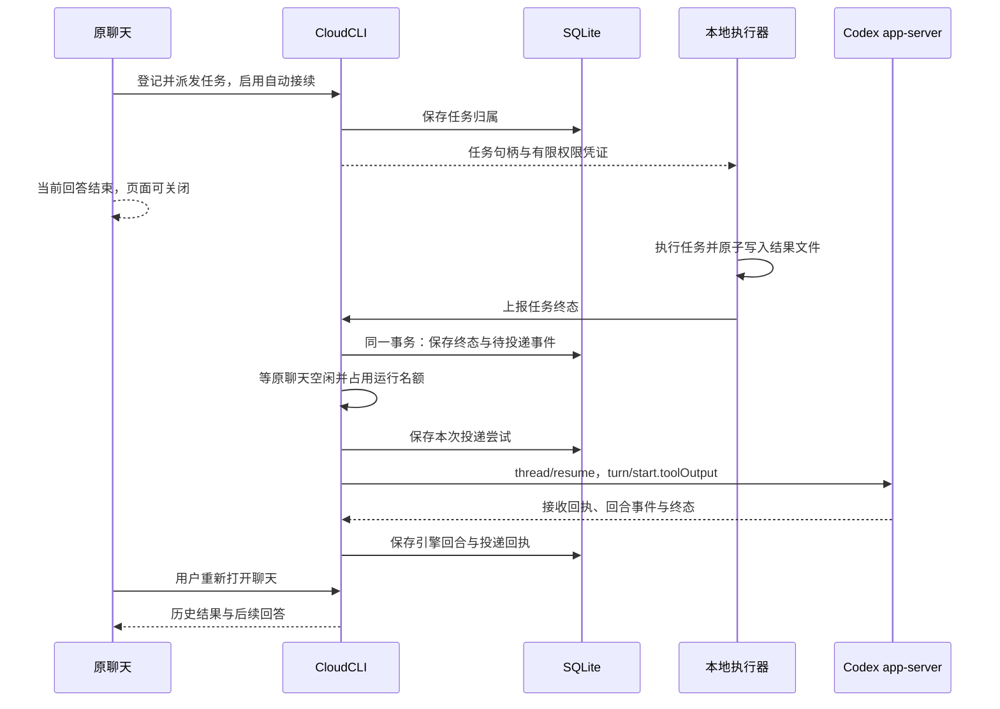
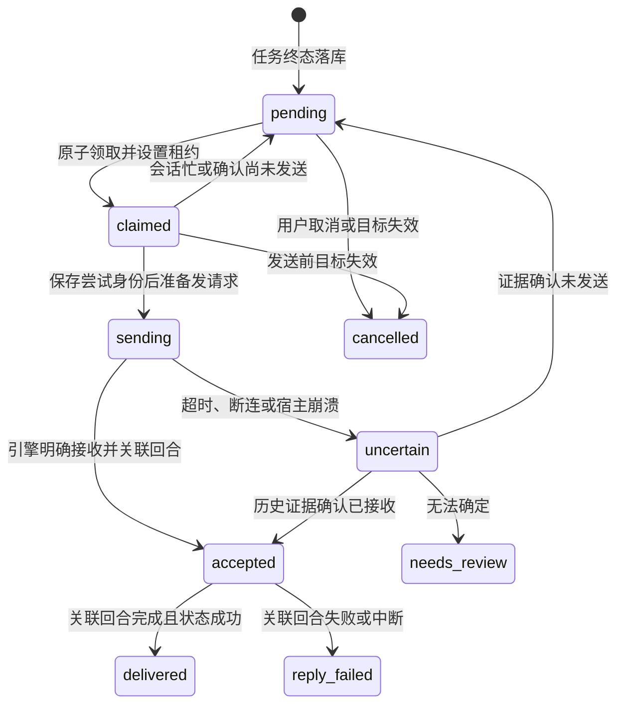

# 异步任务接续

> 状态：待 GLM 实施；实施范围与验收标准以本文为准
> 基准：2026-10-17，代码提交 `a70e6434`；仓库内置 Codex `0.159.2`

## 目标与范围

以太空战士的复核任务为例：原聊天派发复核任务后结束当前回答，用户关闭页面。复核任务结束时，CloudCLI 保存结果，在原聊天空闲时自动续开回答。用户再次打开聊天，能看到任务结果和后续回答。CloudCLI 重启后仍能找回未投递结果，不因重复上报重复续开。

第一版接通 Codex，以及一个真实可用的本地任务派发入口。任务登记、后台执行、结果落地、原聊天续开、回执查询必须一起交付。只有手工调用回调接口才能演示，或者只有模型一直保持回合才能收到结果，都不满足目标。

通用队列不绑定引擎名。第一版其他引擎明确返回不支持宿主接续，不自动注入普通用户消息。ZCode、Claude、Antigravity 引擎内部自带的后台回报继续由引擎处理，不同时登记宿主自动接续，避免双重回答。任意脚本和其他终端任务不会自动被发现；必须经过登记入口或显式接入结果上报。

任务执行成功、模型汇报成功、项目验收通过是不同事实。命令退出码为零只表示执行器成功，不能据此声称产物已验收。自动续开仍遵守原会话的工作目录、权限和审批设置。无人在线时遇到审批就等待用户，不自动放行。自动回复可能继续调用工具，登记时必须明确启用自动接续，并给执行器和模型设置任务范围。

## 已核对的代码与接口

| 证据位置 | 已有行为 | 实施约束 |
| --- | --- | --- |
| `server/modules/providers/list/codex/codex-runtime.provider.ts` 的 `queryCodex` | `thread/resume` 恢复原线程，`turn/start` 启动回答，回合结束后关闭连接 | 不要求常驻 Codex 子进程；不能依赖回合结束后的通知继续被接收 |
| `server/modules/providers/list/codex/codex-app-server.client.ts` | 使用包内 Codex，启动并初始化 app-server | 不使用 PATH 上另一份 CLI 验证兼容性 |
| `server/modules/websocket/services/chat-websocket.service.ts` 的 `runDetachedChatTurn` | 没有浏览器也能启动原聊天，接入运行登记和事件广播 | 复用运行路径，增加任务输入和真实终态回执 |
| 同文件的 `dispatchRun` | 返回 `started/error`，运行时也可能通过完成消息报告失败 | 不能把 `started: true` 或 Promise 正常返回当成汇报成功 |
| `server/modules/websocket/services/chat-run-registry.service.ts` | 按会话限制并发，登记完成原因和退出码 | 在实际占用会话的位置处理竞争，不能只做派发前检查 |
| `server/modules/scheduled-messages/services/scheduled-message-dispatcher.service.ts` | 定时消息使用无人在线运行入口，设置 `interruptActiveRun: true` | 任务完成通知等待空闲，不能沿用抢断策略 |
| `server/modules/providers/list/zcode/zcode-runtime.provider.ts` 的 `subscribeToSessionEvents` | `desktop-continuous` 订阅引擎事件 | 订阅事件与持久投递是两种机制，不能据此前提宣称宿主重启可恢复 |
| `codex-thread-items.ts`、`codex-sessions.provider.ts` | 当前没有针对 `functionCallOutput` 的完整接续结果转换 | 同时验证实时和历史，不能只补发送请求 |
| `server/modules/auth/auth.middleware.ts` | 普通接口使用用户认证；平台模式有专门分支 | 本地回调也必须校验任务凭证，不能依赖“来自 localhost”或平台模式免认证 |

OpenAI 官方 [App Server 文档](https://learn.chatgpt.com/docs/app-server)提供恢复线程、启动回合、提交独立工具输出和读取历史的接口。`turn/completed` 还可能表示失败或中断，必须检查状态。官方协议不替 CloudCLI 保管任务队列，也不提供本文所需的宿主投递事务。

本次从仓库内置 CLI 导出的 `v2/TurnStartParams.json` 包含 `toolOutput`。这只证明字段存在；真实调用能否正确续开、结果是否完整落入历史、能否可靠关联返回回合，仍是实施前置验证。

## 方案与代价

采用 SQLite 任务登记和待投递表，后台派发器复用现有聊天运行路径，Codex 适配器使用官方 app-server 协议。任务终态与待投递记录在同一事务写入，这种做法通常称为事务发件箱。浏览器不负责唤醒。

常驻引擎订阅适合引擎自有子任务，但不能单独解决外部任务归属和宿主崩溃后的补投。独立消息中间件适合多实例和跨机器执行；本仓库当前的单宿主方案先使用 SQLite。引入中间件会增加运行依赖，却仍然需要解决引擎已接收、数据库未记回执的问题。

第一版不承诺模型绝对只执行一次。可确定未发送的事件允许自动重试；已发送但接收结果不明的事件必须先核对，无法核对就保留待确认状态，不盲目重发。



## 任务入口与信任边界

实现一个随构建产物分发的本地执行器入口，支持“登记后执行命令”“查询任务与投递状态”“取消尚未投递的接续”。命令参数以 argv 数组传递，不拼接 shell 字符串。确实需要 shell 的任务由调用方显式传入 shell 和脚本参数。

约定通过环境变量 `CLOUDCLI_TASK_RUNNER` 提供构建后的执行器入口绝对路径，供聊天内的命令工具调用。下列命令是待实现的使用契约，不是当前已有命令。`--notify` 表示允许任务完成后自动续开，未指定时只保存结果。`status` 同时返回任务执行状态和通知投递状态，`cancel-notification` 只取消待发送的通知。

```sh
node "$CLOUDCLI_TASK_RUNNER" run --title "过去世界起点复核" --notify -- node ./tasks/recheck.mjs
node "$CLOUDCLI_TASK_RUNNER" status --task <任务ID>
node "$CLOUDCLI_TASK_RUNNER" cancel-notification --task <任务ID>
```

宿主在本轮可信运行上下文中注入入口位置和使用说明，凭证值不放进说明。执行器通过环境读取宿主地址和有限权限凭证，不能通过 argv 接收凭证。原聊天在发起任务时就返回任务 ID 和查询入口，不能要求用户等任务完成才知道身份。实施前置探针必须验证 Codex 命令工具在原权限配置下确实能拿到这些环境变量并访问回调入口；受沙箱或环境继承策略限制时，应修订接入方式，不能扩大整个会话权限来迁就执行器。

聊天运行时为执行器提供本轮专用的登记凭证。凭证绑定用户、CloudCLI 会话和原运行，只能登记当前聊天的任务。宿主从凭证和数据库确定归属，忽略或拒绝请求中的另一用户、另一会话、另一工作目录。不能要求模型猜线程 ID，也不能把浏览器登录凭证交给任务命令。凭证通过该次子进程的环境传入，不修改全局 `process.env`，不写入源码、聊天、命令行或日志。

登记后发放仅能上报和查询该任务的回调凭证，数据库只存凭证摘要。登记凭证在原运行结束后失效；已发放的任务回调凭证在任务终态提交和重复确认的有效窗口内仍可用，不能随父回合结束一起失效。取消、失效与重复确认规则必须有测试。重启不能令合法未完成任务的回调凭证全部失效。

执行器先登记，成功后再启动后台进程，返回任务 ID 和状态查询方式。后台进程脱离原 app-server 的生命周期，日志写入宿主管理的任务目录；关闭父回合不能杀掉任务。启动失败必须上报失败。只收到登记、没有执行证据的任务保持未确认，不能写成运行成功。

任务命令只继承执行所需环境，移除登记凭证、其他任务凭证和浏览器认证信息。执行器自身保留该任务的回调能力。环境变量不是同一操作系统用户之间的安全隔离；第一版的本地执行器以本机用户可信为前提，不宣称可以隔离恶意本机进程。

执行器先把不含凭证的结果原子写入宿主管理的任务目录，再发完成回调。网络失败时重试，宿主启动时扫描已登记任务的结果文件补录。目录与任务绑定来自数据库，不能按回调传入路径任意读文件。结果文件需要版本、任务 ID、退出信息和可校验的内容；写到一半的临时文件不能被当成终态。执行器被杀或机器断电、没有完整结果时，任务进入待核对，不凭 PID 消失猜成功。

对外接口按职责分开：用户认证接口负责查询和取消；运行登记接口只接受原运行凭证；任务终态接口只接受该任务凭证。复用现有认证模块的公开入口，任务凭证验证留在任务模块，不能把其能力扩展成任意聊天发送。所有输入检查类型、长度、枚举、身份和任务状态。任务产物路径只作为结果数据；需要读文件时另做目录和真实路径校验，拒绝越界及符号链接逃逸。

## 持久状态与投递规则

任务执行状态与通知投递状态分别保存。任务保存原聊天归属和执行结果；投递记录保存事件身份、尝试次数、租约、关联运行、引擎回合及最后错误。具体字段和函数签名由实现代码定义，本文不复制字段表。

任务终态为执行成功、执行失败或执行取消。每次登记生成独立任务 ID；同一业务任务重新执行生成新 ID。任务只接受一次终态，重复提交同一结果返回同一回执，提交不同终态或不同结果返回冲突。内容摘要由服务端计算，不接受调用方声称两个不同结果相同。执行失败和取消也产生通知，供原聊天如实汇报。

每个任务终态对应唯一投递事件，数据库唯一约束负责去重。事件和终态在同一事务内提交；事务失败时两者都不能被认为已保存。任务 ID、事件 ID、宿主运行 ID 和引擎回合 ID 各有用途，不能混用。



`delivered` 仅表示结果投递后关联回答成功结束，不表示项目已验收。审批等待是 `accepted` 的一种等待条件；不能因等待超过租约就重新发一份。回答失败保留 `reply_failed` 和错误，不自动重放整个原任务。用户选择继续汇报时创建有审计关联的新尝试，不能抹掉旧失败。

领取使用数据库事务或条件更新，并校验租约拥有者；过期派发器不能覆盖新派发器的状态。长回答不能阻塞其他聊天的派发；同一聊天按事件落库顺序逐个处理，每个事件独立回执。轮询是丢失内存唤醒后的兜底，完成事件和运行结束事件可以立即触发检查。计时参数集中配置，测试使用可控时钟。

会话是否空闲包含主回合和引擎仍持有的后台工作。派发前检查后仍须在运行登记处原子占用；竞争失败返回有类型的忙状态并回队列，不比较错误文案。用户交互运行优先，后台派发不打断用户；后台先占用时用户发送沿用既有排队或显式中断机制。用户显式中断自动汇报后不能被自动续开再次抢回。

发送前重新核对用户、聊天、引擎和工作目录。聊天删除、用户失效或聊天归属变化时停止自动发送并留存原因，不新建替代聊天。归档会话不自动取消归档，先暂停投递，恢复后再处理。模型和推理强度沿用原会话有效设置；结果正文不能指定模型、目录或权限。

`sending` 是崩溃边界：先持久化事件和尝试身份，再调用引擎。JSON-RPC 请求 ID 不是幂等键。把稳定事件标识放入工具输出，并保存引擎确认的回合标识；恢复时用官方历史读取接口寻找该标识及关联回合。仅仅“没有查到”不能证明没发送，读取失败、分页不完整或历史格式不支持时进入 `needs_review`。

`accepted` 的回合在宿主退出时可能被中断。恢复后核对原回合终态；若已失败或中断，记录汇报失败，不把同一事件再次作为新输入。旧 `claimed` 在确认尚未进入发送后可重领，旧 `sending` 一律先核对。存储用户可查询的最近错误、重试原因和下一步动作，禁止只写控制台后吞掉。

## Codex 适配与消息呈现

网关接受有类型的“任务结果输入”，由引擎适配器选择协议字段。客户端普通 `options` 不得覆盖宿主生成的结果身份、归属或权限。跨模块使用 `index.ts`，多处共用类型遵守 `server/shared/` 约定，不新增散落的 `types.ts`。

Codex 使用 `thread/resume` 恢复数据库绑定的原线程，再调用 `turn/start`，`input` 为空数组，`toolOutput` 携带任务结果。结果正文包括稳定事件标识、任务原始目标、真实终态、摘要、产物引用和汇报范围。正文属于工具数据，不伪装成用户新指令。先验证原配置下的真实协议行为，再固定请求结构。

实时转换和历史转换都支持协议返回的 `functionCallOutput` 及其持久化表示。独立工具输出没有原始 `functionCall`，不能让前端永远等一个不存在的工具卡。优先映射到现有任务通知或结果行；若现有消息契约无法完整表示，再调整公共契约和前端渲染。实时、刷新、重连中的行身份必须一致，不能多出伪用户消息或重复结果行。

终态回执从实际关联的运行事件取得，区分成功、失败、用户中断、审批等待和连接丢失。不能只复用 `runDetachedChatTurn` 当前返回值推断成功。会话正常聊天与定时消息的行为需要回归，不能为了任务结果改变普通发送和抢断语义。

## 实施顺序与预计改动范围

实施者先核对工作区和本文基准的差异。超过三个文件的产品代码改动需要按仓库规则确认计划已获批准；本文是待实施计划，不把文档存在当成实施授权。范围变化时先改本文，再继续。

| 阶段 | 工作与主要位置 | 进入下一阶段的条件 |
| --- | --- | --- |
| 协议探针 | 用临时目录和隔离线程运行包内 app-server，验证结果提交、终态、历史和事件身份 | 保存脱敏请求及事件样本；证明不保持父回合也能续开，否则修订协议方案 |
| 持久状态 | `database` 的 schema、migration、repository、barrel；新增 `task-continuations` 模块的服务与测试 | 先写失败测试，证明事务、唯一约束、状态转换和租约行为 |
| 聊天运行接入 | `websocket` 网关与运行登记、共享契约、Codex runtime 和消息转换 | 先用假引擎证明空闲占用、真实回执、消息身份和崩溃核对 |
| 实际任务派发 | 任务路由、运行凭证注入、本地执行器、构建后入口 | 从原聊天启动真实后台任务，父回合结束后任务仍执行且能落结果 |
| 启动恢复与操作入口 | `server/index.ts` 初始化与清理、任务查询/取消/待确认处理 | 进程重启恢复、重复上报、手工处理待确认状态均可验证 |
| 文档与交付 | 需求文档、核心架构文档、执行器使用说明；必要时更新前端 | 完成验证矩阵、独立代码审查和产品评审 |

`task-continuations` 负责任务归属、结果接收、投递决策和恢复。`database` 负责存取与原子操作。`websocket` 负责占用聊天运行名额和广播。`providers` 负责协议与消息转换。启动入口只装配依赖，避免任务模块、网关和 provider 互相导入形成环。

持久实现放在 TypeScript 后端模块内。本地执行器若需要薄启动脚本，只负责装载编译后的入口，不在脚本里另写状态机。构建、打包和安装后都必须能找到入口，不能依赖开发工作区的绝对路径。

发现重复的占用、终态转换、鉴权或 JSON 校验逻辑时复用或就地提取。不要把定时消息重写成新队列；如需共享，只提取确实相同的运行与回执机制，保留定时消息的显式抢断行为。

## 验证方案

有明确输入输出的逻辑先写能失败的测试，再写实现。新状态机、事务、去重、边界解析和错误映射都属于该范围。覆盖率按仓库现行工具统计，产品代码目标遵守 80% 规则；报告具体命令和实际结果，没有统计就明确写未统计，不能用测试通过代替覆盖率数字。

### 自动化验证矩阵

| 场景 | 驱动方式 | 必须观察到的结果 |
| --- | --- | --- |
| 成功、失败、取消 | 分别提交终态并派发到假引擎 | 原聊天收到真实状态；失败和取消不写成成功 |
| 重复与冲突上报 | 同结果并发提交，再提交不同结果 | 相同结果同回执且只有一个事件；不同结果明确冲突 |
| 事务回滚 | 在终态写入与事件写入之间注入异常 | 两者同时回滚，重试后可正常接收 |
| 多派发器竞争 | 两个派发器领取同事件 | 只有租约拥有者能发送和更新；过期拥有者不能改回执 |
| 用户发送竞争 | 在检查空闲后启动用户回合 | 后台占用失败回队列，不中断用户，不丢事件 |
| 引擎后台驻留 | 主回合结束但后台任务或后续回复未结束 | 宿主等待真正空闲，不因主回合完成就发送 |
| 不同聊天与同一聊天 | 一个聊天长回答，另一个短回答；同聊天多任务 | 不同聊天互不阻塞，同聊天按序且每事件独立回执 |
| 原运行结束 | 登记后结束父回合 | 登记凭证失效，任务回调仍有效，后台进程继续执行 |
| 归属和鉴权 | 错任务凭证、过期凭证、伪造聊天/用户、平台模式请求 | 明确拒绝；不能给别的聊天注入结果；凭证不出现在日志 |
| 输入与文件边界 | 非法 JSON、超长结果、越界/符号链接路径、半写结果文件 | 拒绝或保留待核对，不执行输入内容，不读任意路径 |
| 断线与重连 | 派发时无浏览器；运行中打开或刷新 | 单次回答继续，结果行和回答不重复，稳定映射原聊天 |
| 实时与历史 | 同一结果分别走通知、历史、重放 | 同样的任务身份和内容；无孤立工具卡、伪用户消息 |
| 明确失败 | 引擎通过完成帧报告失败但正常返回 Promise | 记录 `reply_failed`，不能误写 `delivered` |
| 审批与用户中断 | 挂起审批，随后拒绝或取消 | 不放宽权限、不因等待重投，记录真实终态 |
| 目标失效 | 删除/归档聊天、用户失效、provider 不支持 | 停止或暂停并可查询原因，不另开聊天 |
| 停用自动接续 | 有待投递事件时停用功能 | 不再发起新回答，已有结果保留，重新启用按规则恢复 |
| 无原生重复回报 | 引擎自有后台任务完成 | 不再经过宿主队列触发第二次回答 |

### 崩溃恢复验证

使用隔离数据库、临时目录和测试子进程，设置明确的故障注入点。每个注入点先跑一次、终止进程，再从同一数据库启动新的进程；不能只重新构造一个内存对象。

| 注入点 | 恢复要求 |
| --- | --- |
| 执行器写结果后、完成回调前 | 宿主扫描登记目录补录，一条事件 |
| 终态与待投递事件提交后、内存唤醒前 | 轮询找到事件并派发 |
| 领取后、发送意图落库前 | 租约回收后允许派发 |
| 发送意图落库后、调用引擎前 | 先核对；无法证明未发时进入待确认，不能假定安全重发 |
| 引擎接受后、宿主记接受回执前 | 用结果事件标识找到原回合，不能启动第二个回合 |
| 接受回执落库后、回答完成前 | 查询原回合；成功记交付，失败/中断记汇报失败 |
| 引擎完成后、交付回执落库前 | 根据原回合终态补写交付，不再次提交结果 |
| 核对历史接口失败或不能完整分页 | 保留待确认，显示原因，不当作未发送 |
| 执行器未写完整结果就退出 | 保留执行状态未知，不伪造成功，不丢登记记录 |

### 真实 Codex 验收

在隔离开发实例完成，使用包内 CLI 和独立线程，不读取或修改生产任务。准备一个会写固定产物的短命令和一个确定失败的命令。调用真实派发入口，记录原聊天 ID、任务 ID、事件 ID、引擎回合 ID 和产物路径，凭证全部脱敏。

1. 从聊天派发任务，结束父回合并关闭浏览器。确认后台进程仍运行，任务结束后原线程出现自动回答。
2. 打开原聊天，核对结果行和回答；刷新并重新连接，再核对历史与实时一致。另一个聊天没有收到任何任务内容。
3. 重复上报同一结果，核对数据库事件和原线程回合记录，证明没有新增第二次汇报。不能只凭页面看起来没有重复判断。
4. 在任务运行期间停止隔离宿主，再启动同一测试实例，核对结果补录和续开。真实进程重启测试和假引擎崩溃注入都要保留证据。
5. 让原聊天处理另一条用户消息，任务在此时完成。核对用户消息没有被任务通知中断，空闲后才汇报。
6. 执行失败命令，确认原聊天报告失败。让汇报阶段失败或被中断，确认不会将其写成任务重新执行，也不会写成已成功交付。
7. 核对执行器在构建并打包安装后仍能启动和回调。开发目录可用但安装产物不可用视为失败。

若当前账号或环境不能完成真实 Codex 调用，保留所有探针和自动化结果，明确标记真实接通尚未验收。协议 schema、假引擎和截图都不能替代这项验收。

### 回归、审查与交付证据

先跑新增模块和修改模块的定向测试，再运行 `npm test`、`npm run test:client`、`npm run typecheck`、`npm run lint`、`npm run build`。纯后端阶段可以先跑后端定向检查，完整交付仍需说明各检查是否执行。失败保留实际输出和是否为基线问题的对照，不把失败写成通过。

横向回归普通 Codex 聊天、定时消息、持久排队消息，以及 ZCode、Claude、Antigravity 的原生后台回报、停止、重连场景。实际跑过与仅查源码的结论分开记录。新增协议类型后检查所有归一化、历史和前端消费者，不能只修 Codex 的发送函数。

实现完成后安排独立代码审查；产品行为有变化，再安排独立产品评审。委托只给背景、改动范围和验收目标，不预置“实现正确”的结论。审查重点包括崩溃后重复执行、权限等待、任务失败被伪装为成功、用户中断被后台续开覆盖，以及暂停和撤回路径。

同步新增需求文档，更新 `docs/core/overview.md` 的持久化与进程关系、`docs/core/providers.md` 的结果输入和能力边界、`docs/core/chat.md` 的派发与回执规则。只有实际改变共享前端契约或渲染时才更新 `docs/core/frontend.md`。新增文案与日志标签按仓库现有规范登记；设计稿只在本页头部状态行记录实施进度，验证产物另存报告，不把流水账塞回正文。

交付报告给出可运行命令、脱敏事件样本、测试与覆盖率输出、故障恢复记录、独立审查结果、仍待确认的边界和使用入口。用户必须能查到任务已执行、结果已入队、等待空闲、审批等待、已交付、汇报失败或需人工确认；不能只从服务器日志推断。

## 启用、停用与生产边界

自动接续采用显式开关，默认关闭；任务登记也明确记录是否自动接续。关闭开关停止领取新投递，不删除结果、不强杀已在运行的任务或回答。取消待投递通知与停止实际任务是不同操作，第一版取消入口必须说清取消的是自动汇报。对已接收但未结束的回答，沿用原会话停止入口。

第一版提供认证后的状态查询、取消和待确认处理入口及可运行的使用说明，不要求新建完整任务管理页面。人工重投需显式提示“此前可能已执行”，记录操作者与原因。不能通过清库或改状态字段掩盖不确定性。凭证过期、结果保留和清理策略集中配置，未交付和待确认记录不能被普通清理删除。

迁移采用增量表结构，保留旧聊天、定时消息和草稿数据。停用功能即可停止新接续，撤回代码不主动删除新表。原版不识别的记录保持原样，供恢复后继续核对。

实施 Agent 不得运行 `pnpm run deploy`、`node scripts/deploy.mjs`、`pm2 restart` 或任何间接重启生产的命令。真实崩溃验证只对隔离测试实例执行；生产部署和 PM2 重启只能由用户操作。需要生产验收时先交付已验证的改动与准确命令，等待用户执行后再做只读核验。
