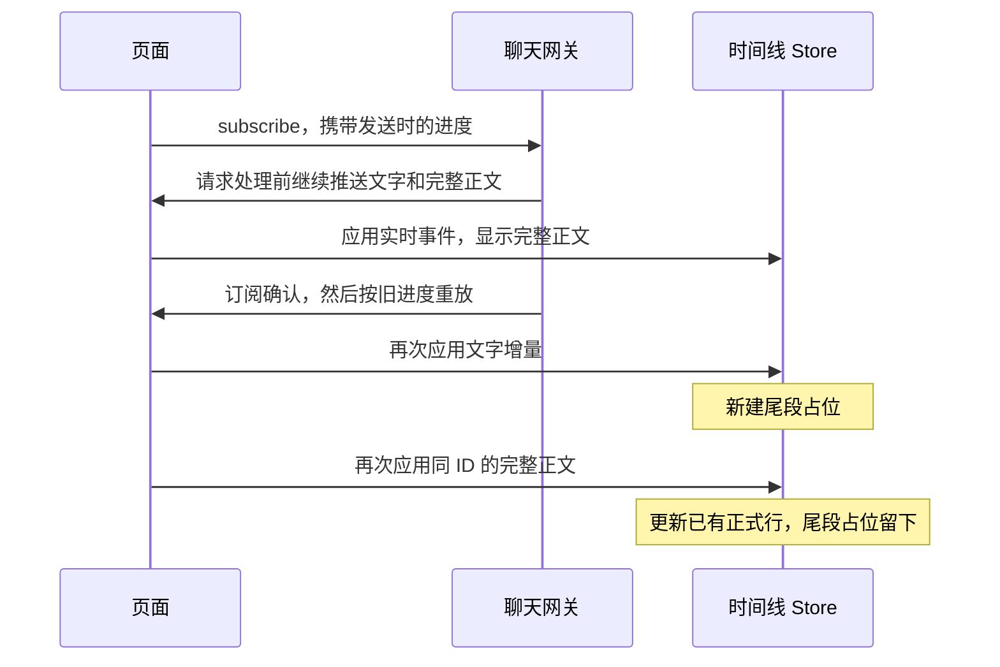
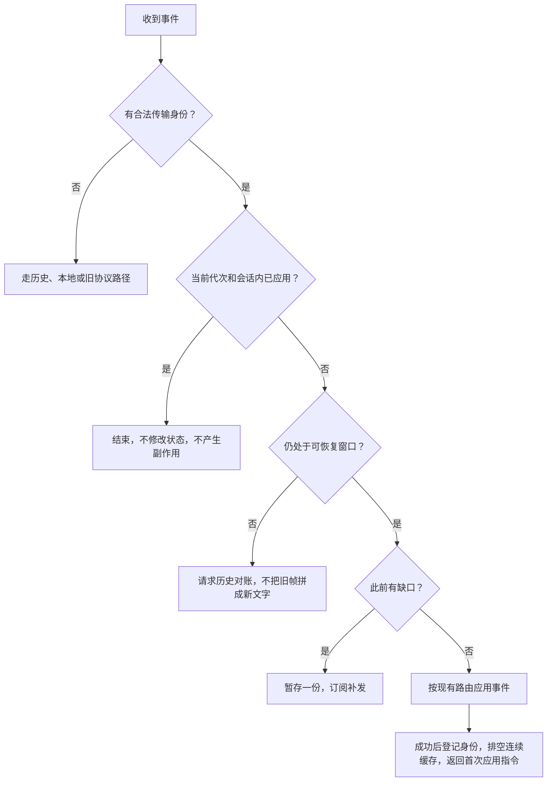

# 聊天事件重放

> 基准：2.10.0 / 2026-10-20
> 状态：已完成代码、自动回归与独立代码和产品评审；未部署，浏览器断网验收未执行

## 现场与修复目标

一次 Codex 回复已经完整显示，页面随后又显示从“用 app-server 保存标题”开始的回复尾段。Markdown、HTML 和诊断报告都包含这条尾段，因此重复发生在消息状态层，导出器和 Markdown 渲染器只是把已有消息显示出来。

诊断报告的采集时间是 `2026-10-19T14:18:44.511Z`，页面构建为 `v2.10.0-b7f166e8`。报告记录了以下顺序，时间采用浏览器记录的本地时间：

| 时间 | 页面收发的事件 |
| --- | --- |
| 22:17:04.362 | 页面发送 `chat.subscribe` |
| 22:17:04.942 | 页面收到序号为 `931` 的完整回复 |
| 22:17:04.994 | 页面收到 `chat_subscribed`，随后再次收到序号 `818` 至 `931` 的事件 |
| 22:17:05.085 | 第二份完整回复和后续完成事件到达 |

两遍事件的序号、事件 ID、类型和摘要相同。重复的文字增量拼接后，与导出文件里的独立尾段逐字相同。时间线同时保留引擎命名的完整回复和前端生成的 `__streamed_…` 占位行。

回放使用诊断报告里的顺序和文字增量，并从 Markdown 补齐被诊断摘要截断的完整正文。原样回放会产生重复尾段；让相同事件只应用一次，时间线只保留完整回复。这是经过补齐的事件回放，不是完整原始网络抓包。

当前时间线代码和 10 月 16 日 `4925f31d` 的时间线代码都能复现。证据确认了事件被重复应用，尚未确认近期哪项变化增加了触发频率。Claude 用户提问重复来自模型请求诊断快照被误当成对话，属于另一条输入边界，修复见 [Claude 转录记录筛选](Claude转录记录筛选.md)。

修复目标是：同一服务端事件无论通过实时推送还是重放到达，都只应用一次；真正遗漏的事件仍能补上。修复覆盖所有经过公共聊天网关的引擎。

## 原因

页面发送订阅请求时，只能带上发送那一刻的接收进度。请求到达服务端之前，实时连接仍会收到后续事件。服务端按请求里的旧进度补发，这批补发事件便可能与刚收到的实时事件重叠。这种重叠不要求断线，正常订阅期间也会发生。

`SessionTimelineStore.applyServerEvent` 收到有序号的事件后，只调用 `noteSeq` 更新进度，没有检查事件是否已经应用。于是重放的文字增量再次进入流缓冲。

第二份完整正文到达时，`appendRealtime` 先调用 `replaceRealtimeRowById`。第一份完整正文已经存在，所以替换分支直接返回，`adoptEngineRow` 没有机会接管第二遍增量生成的占位行。没有原生行 ID 或共同 `providerRowKey` 的占位行也不能靠历史刷新退出。

依据见：

- [服务端订阅与重放](../../server/modules/websocket/services/chat-websocket.service.ts)：`handleChatSubscribe`。
- [服务端事件编号](../../server/modules/websocket/services/chat-run-registry.service.ts)：`decorateAndRecordEvent`、`replayEvents`。
- [前端事件应用与占位接管](../../src/modules/chat/utils/sessionTimelineStore.ts)：`applyServerEvent`、`appendRealtime`、`adoptEngineRow`。

## 方案选择

| 方案 | 代价与适用边界 | 决定 |
| --- | --- | --- |
| 减少页面重复订阅 | 改动较小，能减少触发机会；连接恢复和真实会话切换仍需要重放 | 不作为根治措施 |
| 把占位接管放在正式行替换之前 | 改动较小，但可能错认其他占位，也不能阻止思考增量和完成副作用重复执行 | 不采用 |
| 仅用前端的序号与事件 ID 精确判重 | 能挡住此次原样重放；缺少服务端代次时，重启后的序号空间仍有歧义 | 可作应急补丁，不纳入本方案 |
| 服务端声明序号代次，前端记录实际应用过的事件 | 需要同步修改协议、网关、Store 和测试；能明确区分重放、新事件和服务端重启 | 采用 |

如果只需要短期挡住这一个 Codex 现场，完整方案比前端局部去重更贵。本次需要覆盖多引擎和重连场景，局部补丁会留下同一机制的兄弟问题，因此采用公共协议方案。

## 事件身份与消息行身份

网关启动时生成一个随机的 `streamEpoch`，表示这一次网关进程的序号空间。普通回合切换、后台回复和重放缓存回收不改变这个值；进程重启产生新值。服务端在分配 `seq` 的同一处附加 `streamEpoch`，缓存和重放保留原值，不重新编号。

一个传输事件的身份是 `(streamEpoch, sessionId, seq)`。同一事件再次到达表示重放，不再次修改状态，也不再次返回通知、结束或刷新指令。

消息行仍使用现有的引擎行 `id` 和 `providerRowKey`。同一消息行可以收到多个不同事件，例如一张工具卡连续更新参数。只要传输事件身份不同，前端就必须继续应用，不能因为消息行 ID 相同而丢弃。

这个判定不依赖正文。两个不同事件即使文字相同，也都必须保留。

`streamEpoch` 属于网关的传输信封，不交给各引擎生成，也不要求把它写进引擎历史。历史行与实时行的原有身份对账机制继续负责占位接管和历史合并。

## 前端应用规则

公共去重入口放在 `SessionTimelineStore.applyServerEvent`，位于流缓冲刷新、文字追加、思考累计和指令生成之前。所有带合法传输身份的事件共用这一个入口，不能让各事件分支分别维护去重逻辑。

例如，页面已经按顺序处理到同一代次的事件 `931`，再次收到事件 `818` 时直接结束本次应用。如果页面只处理到 `817`，却先收到 `931`，就暂存 `931` 并请求补发；前端先补齐中间事件，再应用 `931`。收到较大的序号不等于中间事件已经处理。

Store 分开维护服务端公布的水位与实际应用记录：

- `chat_subscribed.lastSeq` 只说明服务端已经产生到哪里。服务端先发送确认、再发送重放，所以确认不能把这些重放事件提前标记为已处理。
- 实际应用记录只登记成功应用的事件。状态应用失败时不登记成功，错误沿现有错误链路报告；缺口未解决前不继续应用后面的增量。
- 订阅游标只前进到已应用或已经完成历史对账的连续位置。存在缺口时保守重放，不能把最大的已见序号直接当成全部完成。
- 重复事件不再返回副作用指令。重复 `complete` 不能再次触发完工音效、清理状态或请求历史。

同一代次、同一会话的事件按序号应用。缺口之后的事件进入有界待处理缓存，同一身份在缓存中只保留一份。缺口补齐后，Store 顺序排空缓存。这样既不会吞掉迟到的缺失事件，也不会把较早的文字增量追加到较晚的文字后面。

缓存排空仍按单事件推进：先应用一条事件的状态，登记成功，再让接收处理器执行这条事件的指令，然后处理下一条。不能把多条事件的状态全部应用完，再只返回最后一条指令。实施时同步调整 Store 与 `useChatRealtimeHandlers` 的调用契约，保持状态与指令的逐事件顺序。

没有传输序号的历史行和本地乐观消息不进入这本事件账。它们继续走各自的消息行合并规则。

## 重连、重启与内存边界

同一服务端进程内重连时，代次不变。Store 保留实际应用记录，重放中已处理的事件退出，未处理的事件继续应用。

服务端重启后，代次改变，新的序号可以重新从起点增长。前端不能用旧代次的序号压住新事件。前端重置旧传输游标和流缓冲的归属，重新订阅并刷新历史；已有可见消息保留，只有现有消息身份对账能够证明被接管时才移除。旧代次的增量不能与新代次的增量拼成一段。

`WebSocketContext` 只分发当前有效连接的帧。旧 socket 在新连接建立后的迟到回调不能切回旧代次，也不能清理新连接的状态。当前连接上的代次与订阅确认必须一致；不一致时记录协议错误并重新建立订阅，不猜测代次先后。

新连接以订阅确认建立代次；确认之前到达的带代次事件先进入有界缓存，确认后再处理。连接恢复时主动发送订阅，不能依赖收到正文后才触发确认。首次订阅遇到历史序号缺口时，先走下面的历史对账，再顺序应用新事件。

应用记录需要有界，不能为每个流式碎片永久保留一个条目。每个会话记录已经完成历史对账的基线，以及基线之后连续应用到的位置；缺口之后的事件只进入待处理缓存，不能推进连续位置。服务端在订阅确认中声明当前能够完整重放的序号下界，前端用它判断缺口是否仍可补发。待处理缓存同时限制条数和字节数，容量和重放限制以共享代码常量为准，前后端不各抄一份。

窗口推进不能伪装成“所有旧事件都应用成功”。缺口超出服务端重放能力时，前端进入 `stale` 恢复：保留已有可见输出，刷新历史，并使用订阅确认中的后台任务和权限状态对账。对账成功后才能建立新的恢复基线，清理基线之前的事件账；失败时保留待恢复状态并报告错误。窗口外迟到帧不再作为新正文执行。

历史恢复失败后，接收器保留一个会话对应的在途恢复请求，并按退避定时重试。延迟上限以接收器代码为准。失败提示复用现有错误卡，说明正在自动重试、已有内容保留，用户也可以刷新页面重试；恢复成功移除提示。连接更换、恢复标识更换和组件卸载会作废旧重试。恢复标识属于一次具体恢复，旧请求完成不能确认新连接的恢复基线。

Store 把观察者通知放在状态提交和事件登记之后。界面通知抛错会报告，但已经成功写入的思考增量不能再次执行。真正的状态应用失败仍保留未应用状态，不推进连续游标。

历史恢复只能补回引擎保存的内容。服务端已经丢失、浏览器也从未收到、引擎又没有落盘的输出无法凭空恢复；本次修复不通过删除现有占位来掩盖这个限制。

## 兼容与发布

新增传输元数据在协议类型中允许缺省，以兼容已经打开的旧页面。新网关为自己编号的事件和订阅确认统一提供代次，忽略引擎输入里的同名值。序号必须是合法的正整数，代次必须是非空字符串；存在但不合法的元数据按协议错误处理，不能悄悄降为旧协议。

新前端遇到没有代次的旧服务端时，保持旧协议的接收行为，不启用基于序号的新过滤。完整修复要求前后端同时具备代次协议，不能只更新前端就宣称问题已经解决。收到新协议的订阅确认后，前端建立新代次的处理账，不继承旧协议里未经证明的最大水位。

旧前端连接新网关时继续使用原有行为，因此旧页面需要重新加载才能获得修复。服务端增加代次不会改变引擎历史格式，不需要迁移会话文件或数据库。

发布前在开发工作树验证，部署和 PM2 重启仍由用户执行。回滚代码不需要回滚聊天数据。

## 实施范围

| 范围 | 职责 |
| --- | --- |
| `shared/protocol/chatEvents.ts`、`frames.ts`、`frameNarrowing.ts` | 声明并校验网关代次、订阅游标与恢复窗口的传输契约 |
| `server/modules/websocket/services/chat-run-registry.service.ts` | 生成网关代次，为事件编号，保留重放身份，报告可恢复边界 |
| `server/modules/websocket/services/chat-websocket.service.ts` | 校验订阅进度，识别代次变化，返回确认和正确的重放范围 |
| `server/shared/normalized-message-contract.ts` | 同步信封字段白名单和边界校验，保证引擎不能伪造网关元数据 |
| `src/modules/chat/utils/sessionTimelineStore.ts`、`sessionEventReplay.ts` | 统一判重，分开水位与应用记录，管理代次、缺口与恢复基线 |
| `src/modules/chat/hooks/useChatSessionState.ts`、`useChatRealtimeHandlers.ts`、`ChatInterface.tsx` | 发送带代次的订阅进度，执行恢复指令，不另建事件账 |
| `src/shared/context/WebSocketContext.tsx` | 隔离旧连接的迟到回调 |
| `src/shared/diagnostics/frameRecorder.ts` 及报告类型 | 记录代次、订阅游标与确认范围，使后续报告能区分重复事件和序号重置；不增加全文采集 |
| 各模块所属测试 | 锁定现场回放与下面的兄弟场景 |
| `docs/core/chat.md`、`docs/core/frontend.md` | 同步事件身份、接收边界与诊断机制 |

订阅因标题或项目元数据变化而额外执行的问题不作为本次修复的前提。正常重连仍可能产生重放重叠，公共入口必须独立处理正确。

## 验证与交付条件

先把本次现场整理成仓库内可重复运行的测试夹具。夹具保留决定问题的事件顺序、身份和文字分段，用中性文字代替真实聊天内容，不依赖本机导出目录或临时文件。

| 场景 | 必须满足的结果 |
| --- | --- |
| 本次完整正文与尾段重放 | 未修复时复现；修复后只显示完整回复，尾段占位不出现 |
| 同连接重复订阅、断线后重放 | 已处理事件不重复应用，尚未处理的事件补上 |
| 确认先公布较高水位，再补较低序号 | 尚未应用的重放不被确认水位吞掉 |
| 先收到较高序号，再补较低缺口 | 缺口中的新事件仍能应用，实际应用记录不伪造连续进度 |
| 一次补发填上缺口并释放多条缓存 | 状态和指令逐事件按序执行，没有指令被合并或遗漏 |
| 同消息行 ID 的不同事件 | 工具参数、正文快照和其他正常更新继续生效 |
| 相同正文、不同事件身份 | 两次真实输出都保留 |
| 重复思考增量 | 思考文字只累计一次 |
| 重复工具、结果、状态与完成事件 | 卡片不增加副本，完成和通知指令只返回一次 |
| 多会话及多引擎交错 | 去重记录相互隔离，公共规则不按引擎名分支 |
| 服务端重启、序号重新开始 | 新代次事件正常显示，旧进度不阻挡新输出 |
| 旧连接迟到、旧代次迟到 | 不覆盖新连接和新代次状态 |
| 重放窗口淘汰、历史刷新失败 | 内存保持有界，已有输出保留，恢复失败不被记为成功 |
| 旧协议与非法元数据 | 旧协议走明确兼容路径；非法值产生可诊断错误 |
| Store 或事件处理抛错 | 错误被报告，该事件不被误记为成功应用 |

先运行各模块的定向测试，再运行 `npm run test:client`、`npm test`、`npm run typecheck`、`npm run lint` 和 `npm run build`。新事件账逻辑覆盖率执行项目门槛，并以覆盖上述状态边界为验收依据，不能只靠覆盖率数字通过。

开发环境还需实测：输出途中反复进入同一会话、断网后恢复、同一消息行持续更新，以及开发服务端退出后重新启动。验收同时查看页面和诊断报告：网络层允许收到重放副本，时间线和首次应用副作用不能出现副本。

代码完成后执行独立代码审查和独立产品评审。交付记录列出每个验证场景的实际结果；没有执行的引擎实测明确标注，不能把公共 Store 的参数化测试称为所有引擎实跑。

## 验证入口与边界

定向回归运行 `npx vitest run src/modules/chat/tests/sessionEventReplay.test.ts src/modules/chat/tests/sessionTimelineSequences.test.ts src/shared/tests/webSocketConnectionIdentity.test.tsx src/shared/tests/frameRecorder.test.ts`。实际网关与信封边界运行 `npx tsx --tsconfig server/tsconfig.json --test server/modules/websocket/tests/chat-run-registry.test.ts server/modules/websocket/tests/chat-background-subscribe.test.ts server/shared/tests/normalized-message-contract.test.ts`。

前端全量运行 `npx vitest run --maxWorkers=4`，后端全量运行 `npm test`。类型、lint 和构建使用项目现有命令，均通过；跳过项和警告以输出为准。事件账覆盖率使用与 Vitest 同版本的 `@vitest/coverage-v8`，按 `sessionEventReplay.ts` 检查行、语句、分支和函数的项目门槛，具体数值由覆盖率报告生成。覆盖率工具通过临时目录提供，没有修改项目依赖。

现场回放使用报告中的到达顺序和正文补齐方式，再增加新协议的网关代次与历史恢复基线。回放只保留完整回复，不产生独立尾段。这证明新入口处理原故障顺序，不代表原报告包含新增协议字段。

独立代码审查覆盖重连与在途恢复冲突、缓存超限与在途恢复冲突、通知失败重复累计和连续缓存排空。回归同时验证状态应用失败不前进游标、观察者失败仍报告错误且继续排空。独立产品评审通过实际 Hook 的失败请求和模拟时钟验证自动恢复、权限请求释放与错误卡移除；持续失败的退避和卸载取消另有回归。

六个引擎名共用同一组 Store 参数化回归，不等于六个引擎的真实对话实跑。浏览器里的真实断网、开发服务端退出与重新启动，以及部署后页面验收没有执行。生产部署和 PM2 重启由用户执行；页面重载后才使用新前端。
